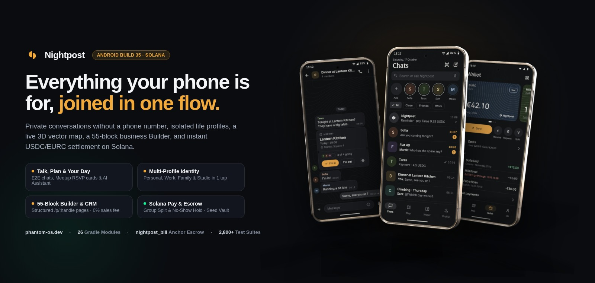
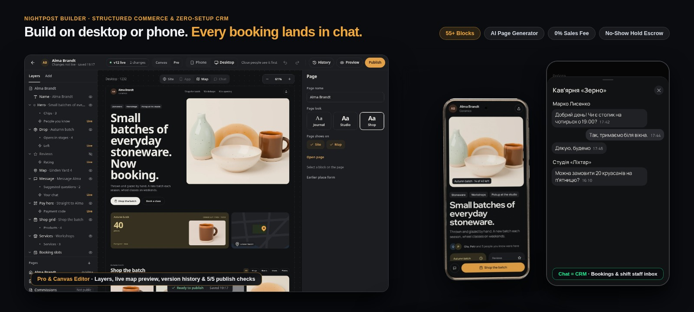

  <a href="https://github.com/Kiril003/nightpost">
    <picture>
      <source media="(prefers-color-scheme: dark)" srcset="docs/img/lockup-dark.svg">
      <source media="(prefers-color-scheme: light)" srcset="docs/img/lockup-light.svg">
      
    </picture>
  </a>

  <b>Your people, places, plans and money — in one flow.</b> 
  Encrypted conversations · Multi-profile life spaces · 3D vector map &amp; routing · Structured page Builder &amp; CRM · Instant USDC/EURC settlement on Solana

  
  
  
  
  

  

---

### Flagship Project — [Nightpost (`Kiril003/nightpost`)](https://github.com/Kiril003/nightpost)

**Nightpost** joins the entire daily and local-commerce loop into one private space on Android & Web (~1.09M lines of code across 26 Android Gradle modules, FastAPI cloud & blind relay, React 18 web platform, and a native Rust/Anchor Solana escrow program):

- **Conversations, Circles & Multiple Profiles:** No phone number required. E2E sealed envelopes, view-once media (`FLAG_SECURE`), voice/video calls, **Your Day** schedule bar, and one-tap switching between isolated life profiles (`Personal`, `Work`, `Family`, `Studio`).
- **3D Vector Map, Routing & Meetup Cards:** Built-in OpenStreetMap 3D vector map (`MapLibre`), offline city packs, GTFS public transit, live venue dossiers, and in-chat Meetup Cards (*"I'm in / I'm out"*).
- **Structured Builder (`/p/:handle`) & Chat-Native CRM:** 55+ modular blocks across *Sell, Book, Classes, Delivery, and Place*. AI generates a structured business page in 60 seconds; customer bookings and questions land straight in the owner's Nightpost chat inbox (`Chat = CRM`) with **0% sales commission**.
- **Self-Custodial Solana Money & Escrow (`nightpost_bill`):** Hardware-backed Android Keystore & Solana Mobile Seed Vault signing, gasless fee sponsorship (`USDC`/`EURC`), itemized group bill `Split` (1–16 shares), booking deposit `Hold` escrow against no-shows, and 3D collectible gifts.

  

### Quick Links

- **Flagship Repository & Full Showcase:** [**github.com/Kiril003/nightpost**](https://github.com/Kiril003/nightpost) *(Architecture, Security, 12 Live Screens & Business Model)*
- **Live Platform & Android Download:** [**phantom-os.dev**](https://phantom-os.dev)
- **Video Walkthroughs:** [**Product Demo (2:19)**](https://youtu.be/HMCDmwgEBbk) · [**Founder Pitch (1:54)**](https://youtu.be/adhv_zvUgwE)
- **Colosseum Arena:** [**colosseum.com/arena/projects/nightpost**](https://colosseum.com/arena/projects/nightpost)

© 2026 Kyrylo Myloserdov. All rights reserved.
